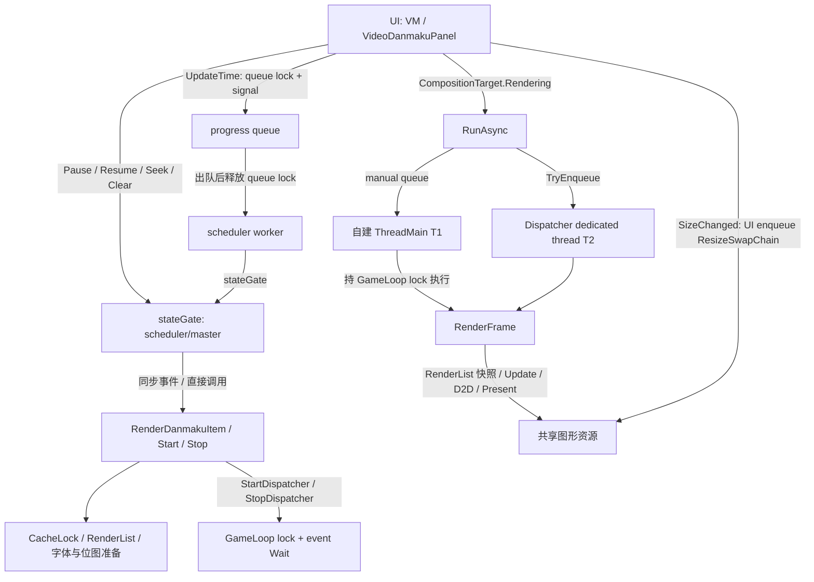

# #49 引擎候选独立根因与架构审查

2026-10-30。**结论：维持公开签名是可行设计方向，但“两文件 scheduler 补丁 + 一个 paused draw 开关”不是安全的最小修复。必须先统一 render 所有权与关闭协议，再实现目标场景的零时间步首帧。此处没有实现，也没有证明新方案运行成功。原候选仍不可发布。**

本轮为高难度 Spike：静态源码、既有二进制、日志和 dump 的只读调查。遵循 systematic-debugging、winui-code-review、winui-dev-workflow、winui-ui-testing、scope-gate，并在交付前使用 verification-before-completion。未启动子代理，未进行第四轮试修。未安装、构建、运行应用或测试、改正式依赖/kernel、push、发布、改 issue/PR。403 应用测试没有重跑。WinUIAnalyzer/AOT 没有运行。**未占用桌面，没有本轮 owned 进程或包，未调用桌面操作或 yield；PID9608、Dev/生产包、凭据未触碰。**

## 1. 证据与可复核范围

- 父集成：`51154f0052f86428282550e2ca8910dccc228a03`；候选：`c15db2d1f52254cd2b49cb7e2bdd8937f750f587`。
- 候选工作区只读：`C:/Users/hp/.t3/worktrees/Bili.Copilot/t3-c9d5219a`。以下 `C/` 指其 `artifacts/engine49/source/danmaku-kernel-4d0f8691f08f1e143294402477e72306a1b38b6f/src/`；`E/` 指其 `docs/performance-acceptance/engine-49-candidate/evidence/`。
- `U/` 指精确上游 commit `4d0f8691f08f1e143294402477e72306a1b38b6f` 的 `src/`。归档 SHA256 `5b6465b63c438cdbfa8c0c2d7697719a677539522d98feeb7c2b7b87f1691bc0` 已重新计算；仅解压至本工作区 ignored `artifacts/engine49-review/upstream/`。
- 完整读取候选 README、scheduler-candidate.patch、rejected-render-experiment.patch、crashes-final.json；读取 partial barrier/timeout/build/provenance 信息和 red/firstchance、red-release/firstchance、engine 小日志。GitHub #49 用 gh 只读获取。应用 AGENTS/docs/agents 已读。
- 原 `artifact-hashes.json` 的 **24/24** 项本轮重新计算匹配，见 [artifact-verification.json](artifact-verification.json)。该清单没有 dump 项；本轮补充 dump hash。归档与最终源码逐个 `.cs` 比对，只有 Core scheduler、Legacy master 两文件不同。因此下文所有 render/GameLoop/resource 行号同时适用于 U 与 C；scheduler/master 使用 **C 行号**，不可拿它定位上游原文件。
- [final-samples.json](final-samples.json) 仅提取累计日志中 **PID49480** 的 34 个 snapshot，保留原 JSONL 行号；不能把累计日志的早期进程混入最终运行。
- 本轮实际查看 Win2D frozen-1/2 原图，确认黄色滚动字位置保持、白色 `CONTINUOUS MOTION` 从第二图消失。其余视觉结论引用候选逐图记录，未冒称本轮全量视觉复验。

**新增证据完整性问题：所谓“最终未插桩”DLL 仍含屏障字段。** 使用 PEReader 只读查看 layout-final 的 Core `DanmakuScheduler`、Legacy `DanmakuFrostMaster`，两者均有 `_testDequeued`、`_testIdle`，而最终 C 源文件没有这些字段。对应最终 UI / final-barrier / 包 DLL 的 hash 相同。这证明“已去钩子源码”不等于“已去钩子产物”；不能用增量构建 exit0 与 DLL 相等来证明源码对应性。见 [inspect-metadata.ps1](inspect-metadata.ps1)、[binary-metadata.json](binary-metadata.json)。null 钩子本身不证明视觉失败由此造成，26 个结果也不因此自动作废；但发布前必须隔离 clean build 后重新确认元数据和映像来源。

## 2. 实际线程、调用和锁序

### 三条控制平面必须分开

1. **scheduler / play-intent**：当前位置、列表游标、旧进度代次、调用者 Pause/Resume 意图。候选 `_wantsPlaying` 是此层意图，不是“已经呈现暂停帧”。
2. **render / game-loop ownership**：文本布局、槽位、位图、帧时间、Draw/Present、resize、Clear/Dispose，必须有唯一可证的串行访问与资源寿命。
3. **Dispatcher lifetime**：队列所属线程、接收/拒绝、排空、Shutdown 完成。不能用播放暂停或 `_dispatcherStarted` 模拟 native queue 已停。



Core 的实际链：panel `UpdateDanmakuTime`（应用 `VideoDanmakuPanel.xaml.cs:297–305`）→ public `DanmakuRenderer.UpdateTime:108–110` → C scheduler `UpdateTime:83–92` → worker `315–325` → `SeekCore:286–298` / `DanmakuRendered:363` → public facade `OnDanmakuRendered:256–258` → render `RenderDanmakuItem:155–282`。事件是同步调用，不是自动转到 UI 或 render 线程。显式 Seek 则在调用线程直接执行 SeekCore。

Legacy 同样是 UI → master queue → Windows ThreadPool worker → C master `382–439` 持 stateGate → `DanmakuRender.RenderDanmakuItem`；CanvasAnimatedControl 的 Update/Draw 有独立动画回调线程。Legacy 实时插入由 UI 直接进入 render；常规调度由 worker 进入，二者都可能和动画回调并发。

**锁序已证实：**状态操作是 stateGate → updateTimeQueue；worker 先取 queue 再释放，之后取 stateGate，没有该路径的 queue→state 嵌套反向锁。可是 stateGate 持有期间会进入 render 的缓存/RenderList 锁、昂贵文本准备及 Start/Stop 等待。因此 UI Pause/Close 可等待 worker 的整个渲染准备区间。不是仅把事件调用挪到锁外就安全：那会重新引入旧 seek 的 Start 覆盖新 Pause，需要有序命令和 render 端代次校验。

**GameLoopThread 不只有一个工作线程。** U `GameLoopThread.cs:85–94` 创建 T1 并让构造者同步等启动；`225–226` 又创建 dedicated Dispatcher T2。`RunAsync:157–180` 在两条执行通道间切换；手动动作在 T1 `237–254` 的 `_lock` 内由 `318–330` 执行。Dispatcher 动作在 T2 `162–173` 执行。`HasThreadAccess:186–193` 只描述 T2。API 的 dedicated-thread 行为见 [Windows App SDK 文档](https://learn.microsoft.com/en-us/windows/windows-app-sdk/api/winrt/microsoft.ui.dispatching.dispatcherqueuecontroller.createondedicatedthread?view=windows-app-sdk-1.8)。

`StartDispatcher:114` 等的是 T1 的状态事件；`StopDispatcher:140` 等的也是 T1 离开 Sleep 轮询后 `282` 的事件，真正 shutdown 行 `132` 被注释。**它不是 T2 drain barrier。** `RunAsync` 忽略 TryEnqueue 返回 false，TCS 可永不完成；TCS 也未使用 RunContinuationsAsynchronously。`Dispose:211` 最多等 T1 五秒，随后释放事件；T1 finally `314` 仍可能访问已释放事件。`296` 的两秒 shutdown wait 不检查是否真的完成。这些是代码可证明的协议缺口，不等于已在 dump 中证明它们引发本次崩溃。

另一个已证实的寿命漏洞：Core `RenderDanmaku:514–526` 复制的是可变对象引用，随后 `529–565` 解锁绘制；`Models/RenderLayer.cs:80–104` Clear 可同时回池/释放这些对象。`_isStopped` 不是借用计数或 fence；检查它与访问 native object 之间有窗口。UI `DirectXResourceManager.OnSizeChanged:491–499` 的 Resize 与 T2 绘制也没有统一所有者。要兑现生命周期保证，必须覆盖这些入口，不能只修 scheduler 锁。

## 3. 暂停静止首帧：已证实的三个断点

**A. 目标内容根本没有提交。** C scheduler `SeekCore:291–294`、master `350–353` 都跳过 `StartMs < targetMs`，显式 Seek 只设游标，没有发目标项。自动 seek 随后才进入 `<= currentTime` 循环。因此从 2s 跳到 20s，测试原列表的 `19.999s` 两项被跳过；不能指望单帧 draw 凭空产生它们。final-samples 显示暂停 seek 后 index=4、time=20000。panel 的“SeekForward”其实是 VM.UpdatePosition→UpdateTime，不是调用公开 Seek；两种路径都要验。

**B. 准备入口仍 stopped。** C 两个 SeekCore 调用 Pause→Stop→最终 Pause，最终 Pause 不清 `_isStopped`。Core render `157` 和 Legacy `188` 在 stopped 时拒绝接收项；Core `Pause:633–637`、Legacy `558–567` 均没恢复 prepared 状态。最终两引擎 pause-before-seek 的 snapshot 是 paused=true、stopped=true，与源码一致。**只修 A 仍会丢项。**

**C. 初始化/绘制被暂停挡住。** Core `OnRenderingSignal:117` 与 `RenderFrame:769` 都拒绝 paused；其 `UpdateLayerDanmaku:419–423` 才设置 FirstRenderTime，而 Draw `533` 跳过尚未初始化的项。Legacy `OnCanvasUpdate:636` paused 时直接返回；`672–675` 才初始化 FirstRenderTime、`705` 才设置 top/bottom X；`OnCanvasDraw:802–805` 又跳过未初始化项。`Pause` 的 Invalidate 不能替代这些初始化。**只把 stopped 清掉，或只请求 Draw，一样不够。**

切换的观测不能简化为 B：两张 paused-switch 样本 stopped=false，说明初始化过程中曾 Start；但 A 与 C 仍在。UI 的 panel Redraw `266–292` 是 SetList→UpdateTime 入队→样式→Pause，worker 可以在 Pause 前开始；没有一个“新引擎首帧已准备并以最新意图提交”的原子事务。

### 最小可证明目标，不是本轮已通过的实现

先只选确定资源已就绪、非零尺寸、单条无密度限制的 **Top @20000ms**：Pause→显式 Seek(20000)，无需后续 tick；必须出现该字且位置/年龄保持。只用 Top 是因为 rolling 在出生时 X=CanvasWidth，delta=0 本来就在可见区外，不能拿滚动出生帧的不可见误判 draw 失败。

必要流水线为：接收当前 generation 的 Seek → 清掉旧 render scene → 选定目标项 → 准备资源并定位 → 初始化 FirstRenderTime 为冻结逻辑时间、计算 Top X → 标记 prepared（和播放意图分离）→ **在 render owner 上执行 Update/layout(delta=0) + Draw + Present/Win2D draw** → 保持 wantsPlaying=false。不得临时 Resume 来借一帧。资源/尺寸未就绪则保留最新版待准备场景，在 CreateResources/size-ready 后继续，不得消费游标后静默丢弃。dirty/version 要在成功 draw 后确认，失败保持待处理；frame request 用“queued-or-running”合并，不能只检查尚未开始执行的 `_isRendering`。

随后必须解决 19.999s 等**目标前仍应驻留的内容**。精确目标 Top 通过只证明基础首帧路径，不满足原 #49 内容正确性。需决策 seek/rebuild 的 active-set 语义：Top/Bottom 的剩余寿命；Rolling 的目标年龄、位置、速度变化历史；密度/槽位如何重建。简单把 `<` 改成 `<=` 会丢掉目标等时项；固定回看 1ms/5000ms 也不证明完整内容正确。需要有界重建窗口或状态快照，单独评审其可见兼容性。

## 4. Win2D 消失：确认症状，不能假装根因已定位

原图与对应最终样本：22:26:35.6861256Z、22:26:36.5343425Z，position=22、lastTime=22000、index=5、paused=true、stopped=false；黄色字保持，白色字消失。列表 snapshot 是调度列表，不是 render item、bitmap 或实际 draw 提交记录。没有动画线程时间、删除原因、bitmap 寿命、每帧异常。

**可排除的直接解释：**“paused 时 Update 继续累计 duration 并删掉 Top，所以白字消失”不符合最终原 render：`636` 提前返回，`707–741` 的删除在其后；已查看最终 Legacy DLL 的 OnCanvasUpdate IL，包含对 `_isPaused` 字段的 volatile 读取和早退（binary-metadata 保留原始 IL）。白色项也不能未经 Mode 记录就当作 Top。暂停后下一次 Resume 的 `args.Timing.TotalTime - FirstRenderTime` 会包含暂停期间，这是静态可见的**另一个**恢复后寿命缺陷，不是这两张暂停图的已证实原因。

剩余竞争路径：Pause 写 flag 前已进入的一次 Update 没有在 list 锁内复核；Draw/sprite batch/RenderTarget 寿命或异常导致部分绘制缺失；宿主构建产物/显示采样对应性。它们目前都只是待判别分支。一个在途回调可以越过 Pause 返回，但没有 item 级日志，不能断言它就是两图相隔约0.85s的消失原因。修改时钟并不能自动证实这些分支。

**下一项最小动态诊断（不是修复）**：从精确来源做隔离 clean build，仅增加单写者内存环形 trace，在真实 Legacy render 的 Pause、Update enter/exit、Draw submit、Clear/Dispose、device-loss、item add/remove 记录 native/managed thread ID、sequence/generation、mode/item ID、X/age、暂停采样、删除原因、RenderTarget identity、异常 HRESULT。屏障置于一次 Update 读 pause 后和实际删除前；UI 不等待该线程，只异步收集。先以暂停前已可见的单个 rolling 与 Top 分别复现，定位“列表已删 / item仍在但未提交 / 已提交但未显示”。一次复现后停止，不改多处开关。若不能复现，保留为未定位并扩展采样，不能转成修复成功。

本轮选择不启动动态宿主：静态/已有证据已足以否定直接发布和第四轮多点试修，却不足以建立此项 item 级因果链。**此项调查未闭环，是交付保留的阻断，不是结论性根因。**

## 5. 崩溃 dump 与失败实验分账

| 证据 | 本轮能证明 | 不能证明 |
|---|---|---|
| 唯一现存 `red/Harness.exe.30952.dmp`，10,548,314 bytes | 外层 `0xc000027b`，CoreMessagingXP+0x93bd6；内层 SE02，HRESULT `0x80004003`，线程58576，nested type=0；模块位于 layout-red | 不能替代后来的 PID47948/46904；内层栈地址未被 dump MemoryList 捕获，无符号化 managed/native 根栈 |
| 同轮 red/firstchance.txt | 两次 NullReferenceException，`DirectXResourceManager.CreateSwapChain`；源码 U `207` 解引用 D3DDevice，此前 `190–199` 未处理创建失败结果 | 没采 D3D HRESULT，不能证明缺 debug layer，更不能证明 GPU 坏了；同轮关联不等于已恢复 stowed 的完整因果栈 |
| PID56004，Runtime 1026；red-release firstchance/log | logger AppendAllText IOException，宿主缺陷 | 不作为引擎 native Close 根因 |
| PID47948 / 46904，两个 final crash 1000 事件 | 两次 render 实验均 CoreMessagingXP+0x93bd6 / 0xc000027b；partial barrier 各只有 DirectX_DequeuedPause；wait timeout | 没有这两个 PID 的 dump/first-chance/error details；同模块/偏移不代表同根因，不得宣布 Dispatcher、GPU 或 driver 已被证实致崩 |

dump SHA256：`3e3f8a820be78d5a3a0d17d19797c5dd78cb025112c3ee9dc47593ea849662db`。[dump-summary.json](dump-summary.json) 给出地址、流目录和映像路径；[read-dump.py](read-dump.py) 用 Python 标准库解析 minidump，不加载进程、不安装 debugger、不扫描/提交 dump 的任意内存文本。复核：

```powershell
python docs/performance-acceptance/engine-49-root-cause-review/read-dump.py C:/Users/hp/.t3/worktrees/Bili.Copilot/t3-c9d5219a/artifacts/engine49/red/Harness.exe.30952.dmp
./docs/performance-acceptance/engine-49-root-cause-review/inspect-metadata.ps1
```

结构依据：[Microsoft STOWED_EXCEPTION_INFORMATION_V2](https://learn.microsoft.com/en-us/windows/win32/wer/stowed-exception-information-v2)。该 HRESULT 是保存的内层错误码；不能把外层报告模块直接当故障组件。现有环境未找到可用 cdb/dotnet-dump，本轮未安装或下载。若需要确定后两次崩溃，只能在获准的独立诊断中采对应进程的完整 stowed/first-chance 与足够内存，失败一次即保留并停止；不能重复恢复 rejected patch 试运气。

## 6. 资源亲和性和最小设计边界

| 资源/动作 | 必须约束的所有者 | 当前违例或风险 |
|---|---|---|
| XAML Grid/SwapChainPanel/CanvasAnimatedControl 的视觉树、尺寸读取、事件挂接/脱离、SetSwapChain | UI 线程；后台只接收尺寸/DPI值快照 | 不能把整个现有 Dispose/资源构造直接 Task.Run；Legacy Close 含 RemoveFromVisualTree |
| DispatcherQueueController 生命周期 | 一个明确持有者；队列回调执行在线程 T2；从存活协调线程异步观察 shutdown | T1/T2 混用；StopDispatcher 仅停止 T1 轮询 |
| D3D immediate context、D2D context/target、SwapChain resize/Present、兼容 target、brush 与 bitmap 使用/释放 | 一个 render owner 串行化所有操作和销毁；这是选定的安全所有权，不是宣称所有 COM 对象天生 thread-affine | UI resize 与 render 并发；scheduler 创建/回收与无锁快照绘制寿命交叠 |
| D3D device / DirectWrite factory / 可共享资源 | 不一概声称必须创建线程使用；按实际 API 线程模型与资源域判断，统一 owner 最小化证明成本 | EnableMultithreadedOptimizations 不代表共享 D2DContext 可以任意并发 |
| Win2D DrawingSession / CanvasSpriteBatch | 本次 Draw 回调范围内创建、使用、释放；不得缓存或迁移 | Draw 返回前 batch flush；trace 应在 batch Dispose 后标记提交完成 |
| Legacy CanvasRenderTarget、render item、槽位、逻辑帧时间 | 动画 render owner 排序创建/使用/退役；UI只发意图，资源事件传入合法 device generation | UI/worker准备、动画更新、UI Clear 并发 |
| 纯调度列表、目标时间、wantsPlaying | 纯数据状态/调度 owner；入口只发布命令，不执行 render | stateGate 跨越 render 边界；Legacy 外部可变列表别名绕过 gate |

**可保持 public void API 和程序集表面，但必须评审行为契约。** 现有 UpdateTime 本已异步；Pause/Seek/Close 应定义为“请求已接受/关闭已线性化”，不应靠同步等 GPU。内部可以有 completion/diagnostic fence，外部不必新增 Task API。Dispose 返回即“所有 native 对象已释放”的强语义与“UI 不等待在途 worker”不能同时凭空保证；若消费者依赖前者，需明确兼容决策，不能悄悄改变。构造时 `_startedEvent.Wait` 也要变成内部 initializing 状态，公开构造返回后排队等待 ready。

建议内部协议，尚未编码：

1. 一个有序入口发布不可变命令（sequence、content generation、最新 play intent、实例 lifetime）。Pause/Resume 不清目标场景；Seek/Clear/SetList/Stop/Close 各有明确失效规则。入口不得持有任何 worker 用于渲染/遍历的锁。用短纯发布临界区或 CAS 发布完整入口状态，不把“generation++ 后另行 enqueue”当原子提交。
2. scheduler owner 只做纯数据选择/重建，形成 batch；native/布局准备移动到 render owner。对长列表选择分段检查 superseded generation。render 应用 batch 前再校验实例/内容 generation；play intent 由排序后的控制命令/最新 intent revision 决定，不从旧 batch 恢复。
3. Core 只保留一个真实 Dispatcher 执行通道，整实例生命周期常驻；Pause/Stop 不创建/销毁 native queue。frame、resize、配置、场景替换、资源退役都入同一 owner。UI CompositionTarget 只合并 request，不持 GameLoop 锁执行帧。不得照搬 rejected patch 的 Task.Run(StartDispatcher)，它仍保留双通道、同步 wait 与关闭竞态。
4. Legacy 使用 CanvasAnimatedControl 的动画线程提交机制处理场景/布局和逻辑时间，UI 保留控件生命周期操作；先核对当前引用的 API 和其关闭行为。不要用 Invalidate 假设 Update 一定执行；首帧初始化独立于正时间步，Draw 读取已经准备的冻结场景。
5. 状态区分 playing / paused-prepared / empty-stopped / closing，另有资源 ready 和 dirty revision；不能继续让 `_isStopped` 同时表示“清场”“禁止接收内容”和“应停止 dispatcher”。

### Close：拒绝旧工作但 UI 不等 worker

- 在入口线性化 closing，一次推进 lifetime/content epoch 并封闭 admission。已抢到旧状态但尚未发布的生产者必须 CAS 失败或被旧 epoch 拒绝；不能只靠入口一次 volatile 检查。
- UI 同步停止产生信号，脱离本实例的 UI 事件/视觉目标；旧实例和新实例持有不同 scene/resource owner，旧实例不得复用新 panel。不在 UI 上 Wait/Join、拿 render list 锁、释放正在用的 native 资源。
- scheduler 尚未开始的工作取消；已在计算的旧工作检查 epoch 后丢弃。已入 render 队列的命令在执行点检查 lifetime。完成状态包括 applied/superseded/closed/faulted，TryEnqueue=false 也必须终结，不能悬挂 TCS。
- 在途帧无法靠 cancellation 撤销已经发给 GPU 的调用。逻辑 Close 的保证应是关闭后不接受/启动旧工作、不再向已脱离 UI 的目标显示；在途资源保活至 owner cleanup fence。若要求 Close 返回前连已经在途的 Present 都结束，则必须另设可异步观察的 drain 契约，不能 UI 同步等待。
- render owner 排空/跳过旧命令，退役 scene、layout、bitmap、context 等；UI-only 清理通过 UI continuation，协调器异步观察 completion，再从仍存活的线程发起/观察 Dispatcher shutdown。只有真正完成后释放等待句柄和 owner 引用；不以2s/5s timeout当作成功。异常必须进入 faulted 终态并可诊断。

## 7. 后续实施顺序、停止条件与验收

scope-gate：整个后续至少 **L（所有权、关闭与可见兼容决策）**；不是原票 M 的自然延伸授权。建议先评审此设计/契约，再拆下面独立 ≤M 的实现切片。大致涉及两个 scheduler、两个 render、GameLoopThread、DirectXResourceManager，以及内部 batch/资源退役边界；不需要新增全局调度框架、重写应用 VM 或公开 async API。若要跨速度历史重建完整 active set、设备重建与所有模式完全等价，范围可能升级 XL，先出独立 Spec/ADR。这里不承诺工期；每个切片都需要真实双引擎失败矩阵和资源完成证据，不能以文件少推断低成本。

| 顺序 | 最小后续工作 | 失败即停止 |
|---|---|---|
| 0 | 确认 Close 返回语义、seek active-set、Clear/Stop/Restart/列表别名兼容；隔离 clean build，确认无测试钩子；一次 Win2D item trace | 源码/产物不一致或消失因果未定位，不进入“已修复”验收 |
| 1 | 只实现有序纯数据 admission/intent/generation 与 render 命令边界，保留已有26原用例 | 任何旧命令越界/新 Pause 被旧 Start 覆盖/UI等待worker即停，不叠加渲染修补 |
| 2 | Core 唯一 render owner + resize/配置/clear/dispose 同序 + 异步关闭；Legacy 对应 owner 协议 | 任何跨线程资源断言、TryEnqueue悬挂、shutdown未完成、native崩溃，立即保留 trace/dump 停止 |
| 3 | Top等时目标的 paused prepared 首帧，再补已决策的 active-set 重建/逻辑时间 | paused 首帧空白、临时播放、重复消费、恢复年龄跳变即停，不能仅靠flag过关 |
| 4 | 原26 + 视觉/生命周期/兼容矩阵 + 包消费验证 | 任何视觉失败不发布；不以采图exit0或403应用测试掩盖 |

后续若改测试，先使用 code-testing/run-tests 技能；本轮未改测试。验收必须至少：

- **原26全量保持**：两引擎 DequeuedPause/Resume/Clear/SetList/Seek/Close；Zero、Threshold5000/5001、Backward、Repeated、Empty、End。保留原始失败和候选通过记录，不替换/删用例来绿。新的异步内部实现应以实际 applied/idle fence 收集结果，不用 sleeps 或 UI低优先回调充当 render完成。
- **补边界屏障**：纯选择后、render接收前、资源准备后、帧开始前、Clear与引用快照之间、Close与入队竞争、在途Present、resize与Draw。阻塞这些 worker 阶段时 UI heartbeat 与 Pause/Close 发布仍能继续；“方法耗时快”不能代替不存在等待链的证据。
- **首帧/视觉**：暂停前 Seek、显式 Seek 无额外tick、双向暂停切换、0ms、目标恰好等时与目标前1ms、非零与初始零尺寸、CreateResources延迟；Top/Bottom可见且无年龄推进，rolling按目标年龄位置核验。普通播放运动、暂停至少超过默认3s寿命再Resume不立刻过期；Win2D白字消失必须 item trace闭环并复验。记录目标 ID/Mode/时间、render first-frame acknowledgment、截图和DLL hash；看见文字不等于目标正确。
- **生命周期**：三次重挂/每引擎、卸载后旧VM/旧batch/旧size回调不触及新实例；hide/show、快速切换/样式合并、资源未就绪时Close、native异常退出、新调用拒绝、queue shutdown失败路径。测试包/进程每轮按身份清理并yield。
- **兼容**：playing与paused分别 Clear→Add/SetList→短跨度Update；Stop后Update/Resume、Restart@0；实时插入不重复播放；Core/Legacy AddDanmakuList结果一致性（Legacy现存 `items.ToList()` 丢旧列表，C:324–329，要先锁定预期，不顺手扩修）；GetDanmakuList/SetList别名、外部对象修改、多生产者排序和突发队列界限。公开签名/程序集依赖/所有既有调用点不变；内部快照化改变别名行为必须明示。
- **产物**：独立缓存 clean build，核对无 `_test*`、无 rejected render路径；本地feed重新restore独立宿主，确认真正运行包DLL而非project reference。JIT/AOT分账，工具链缺失不装、不冒称通过。全播放器/真实视频时钟和长时高密度未验则保留限制。

## 8. 审查结论与仍需决策

**确定根因/缺陷**：旧候选虽解决部分 scheduler intent/代次问题，但暂停目标提交缺失、paused→Stop→Pause 留 stopped、paused阻断初始化/Draw；UI状态锁跨渲染边界；双执行线程/Stop非drain/限时Dispose非完成屏障；Core引用快照无资源寿命保证；最终“无钩子”产物声明不成立。

**仍是假设或未定位**：两次render实验的真实stowed根异常；Win2D白字消失的item级原因；GPU/driver缺陷；Debug D3D创建失败具体HRESULT。不可把这些假设加入“已修复”清单。

需要父集成决策：是否批准上述局限于引擎内部的所有权/关闭切片；接受何种Close完成语义；暂停seek是否要求重建全部仍活跃内容及其位置；是否批准一次仅trace的Win2D诊断。未决前不实现，不发布当前候选。本报告不合入候选代码，不覆盖历史报告。

结束合并以最新本地 `feat/performance-45` 为准，最终 SHA/clean 由交付消息和 git 命令记录给出；本报告不能自嵌自己的提交哈希。提交内容仅本目录的新报告与小型可复核证据。
